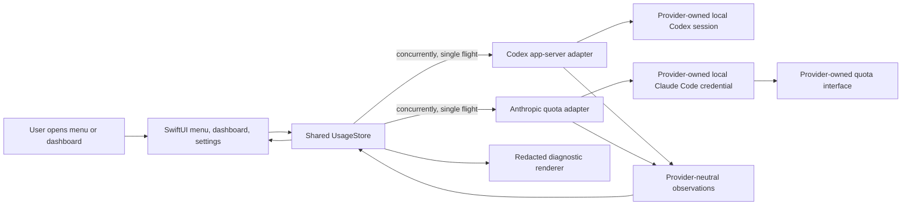

# Architecture

Usage Menu is a native macOS 14 SwiftUI application. Its primary surface is a `MenuBarExtra`; the dashboard and settings are standard SwiftUI windows. All surfaces observe one `UsageStore`, so they render the same readings and refresh lifecycle.

In plain language: a user action, initial surface appearance, or app activation asks the shared store to refresh. The store starts the two adapters independently and concurrently. Each adapter returns provider-specific data that is normalized into observations; the store then publishes the resulting reading states to every app surface. Diagnostics use the same adapters but render only redacted, normalized fields.

## App surfaces

`UsageMenu/App/UsageMenuApp.swift` owns app lifecycle, source construction, and the shared store. `UsageMenu/UI/UsageViews.swift` contains the compact menu, dashboard, settings, accessibility descriptions, and source details. The app is an accessory-style menu-bar utility; opening a window temporarily activates it so that window remains reachable.

## Shared store and state

`UsageMenu/Store/UsageStore.swift` is the refresh boundary. It has no polling loop. The first visible surface performs the startup refresh, app activation is debounced, and manual refresh uses the same method. The store is single-flight: overlapping requests do not start duplicate provider work. Cancellation is forwarded to both sources during termination.

`UsageMenu/Domain/UsageModels.swift` defines provider-neutral observations. An observation retains its provider and account scope, product surface, resource, unit, interval, provenance, independently optional used/remaining/limit values, timestamps, and confidence. Derived values are allowed only for exactly matching scopes. Readings are explicitly `current`, `stale`, `unavailable`, `auth-required`, `unsupported`, or `unknown`.

A refresh temporarily marks prior observations stale. A successful source replaces its own readings with current ones. A failed Codex refresh retains prior observations as stale; without a prior observation it is unavailable. Anthropic transient failures retain only prior observations whose reset is still in the future; sign-in failures are `auth-required`, and unrecognized responses are `unknown`. No failure path produces a current or zero reading.

## Provider adapters

`UsageMenu/Codex/` discovers a configured or locally installed Codex executable and launches its documented `app-server --stdio` interface. Codex owns its authentication. `UsageMenu/Anthropic/AnthropicQuotaSource.swift` reads an existing Claude Code credential only long enough to make a request to Anthropic's provider-owned quota interface. That interface is undocumented and intentionally treated as fragile.

`UsageMenu/Diagnostics/` provides a command-line diagnostic executable that uses the same acquisition code and emits normalized, redacted rows. It does not emit credentials, account references, authorization values, or raw provider responses.
